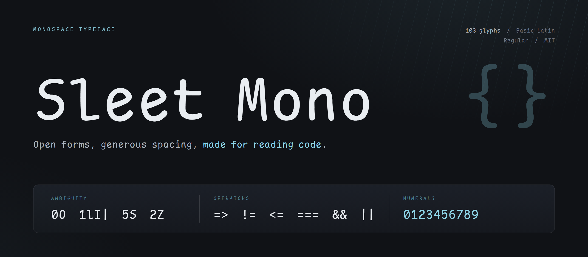
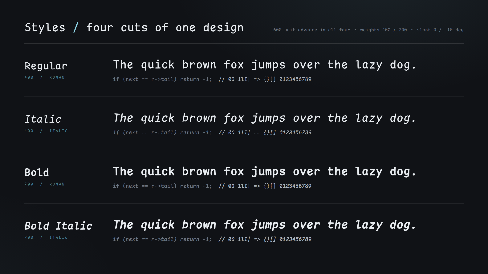
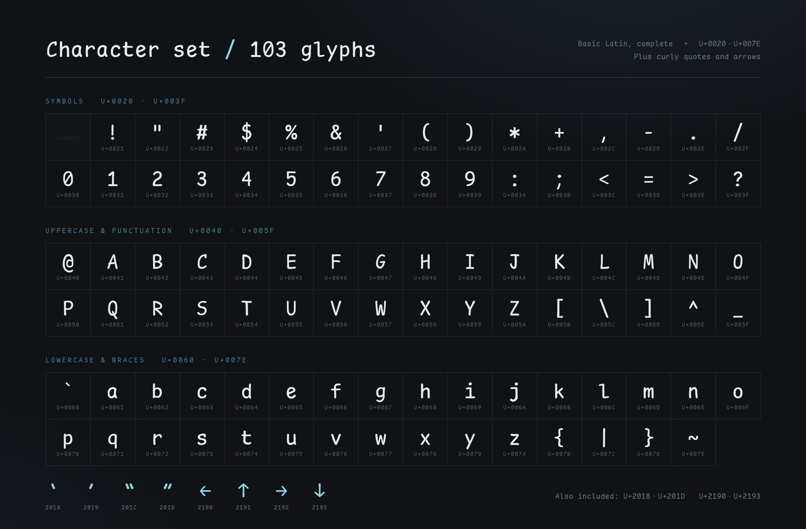
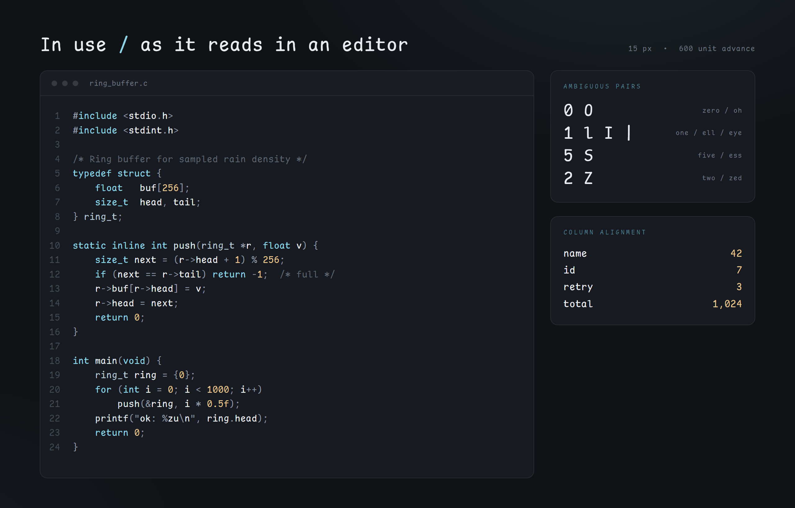
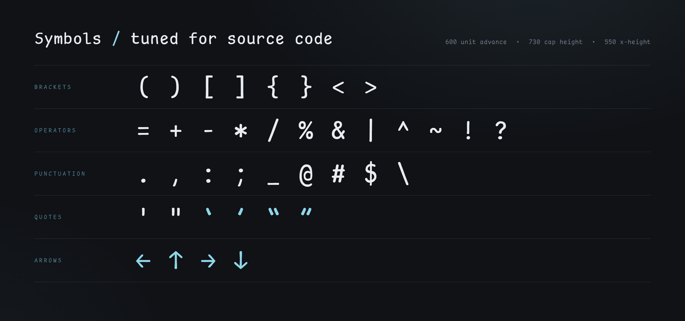

# Sleet Mono

A monospaced programming typeface with a casual, hand-drawn Comic style.
Open forms, generous spacing, made for reading code.



## Styles

Four styles — Regular, Italic, Bold and Bold Italic — share the same 600-unit
advance and vertical metrics, so switching between them never shifts your layout.



## Why Sleet Mono

I love Comic-style typefaces, but I wasn't happy with some of the glyph metrics in
[Comic Shanns](https://github.com/shannpersand/comic-shanns). So I started from its
outlines and reworked the proportions myself, using
[JetBrains Mono](https://github.com/JetBrains/JetBrainsMono) as a reference for the
vertical metrics and spacing.

## Character set

All four styles cover the same **103 glyphs**: complete Basic Latin
(`U+0020`–`U+007E`), plus curly quotes and arrows. More glyphs are in progress —
see the [roadmap](ROADMAP.md).



## In use



## Symbols



## Roadmap

Sleet Mono 1.100 ships all four styles at 103 codepoints. What remains is glyph
coverage and OpenType features, towards parity with JetBrains Mono's 1,372
codepoints and 153 ligatures.

| Milestone | Scope | Status |
| --- | --- | --- |
| M1 | Regular, Bold, Italic and Bold Italic at the current character set | Done inversion 1.100 |
| M2 | Complete the GF Latin Kernel set | Planned |
| M3 | Western European text and typography | Planned |
| M4 | Coding symbols: arrows, math, box drawing, control pictures | Planned |
| M5 | Greek and Cyrillic | Planned |
| M6 | Remaining blocks: APL, double-struck, dingbats, Nerd Font extras | Planned |

See [ROADMAP.md](ROADMAP.md) for the full checklist.

## Installation

### Homebrew (macOS)

```sh
brew install --cask Case3y/fonts/font-sleet-mono
```

For the Nerd Font patched build, which adds terminal and editor icons:

```sh
brew install --cask Case3y/fonts/font-sleet-mono-nerd-font
```

### Manual

Download the four styles from [`fonts/`](fonts/) — `SleetMono-Regular.ttf`,
`SleetMono-Italic.ttf`, `SleetMono-Bold.ttf` and `SleetMono-BoldItalic.ttf` — then
install them with your system font manager.

## Credits

- Glyph outlines derived from [Comic Shanns](https://github.com/shannpersand/comic-shanns)
  by Shannon Miwa.
- Glyph proportions and vertical metrics referenced from
  [JetBrains Mono](https://github.com/JetBrains/JetBrainsMono).

## License

Sleet Mono is licensed under the [MIT](LICENSE) License. 
