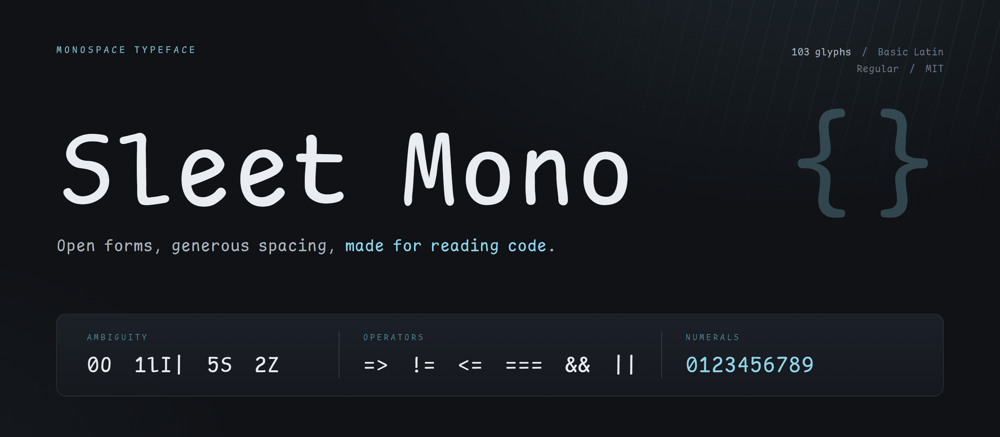
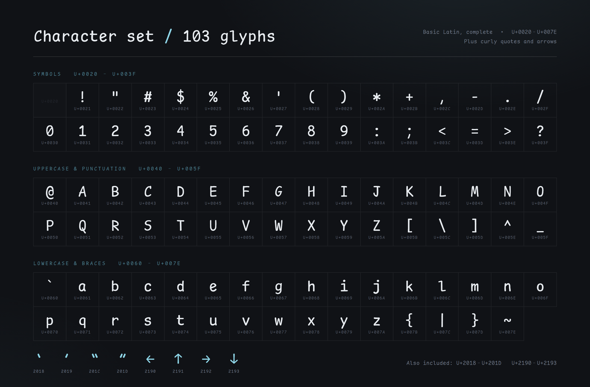
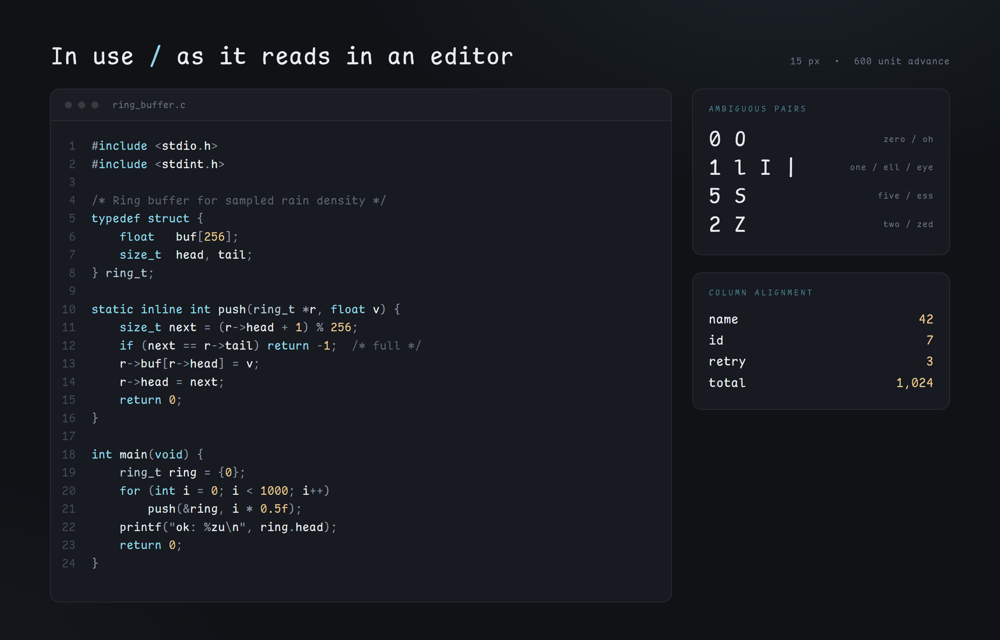
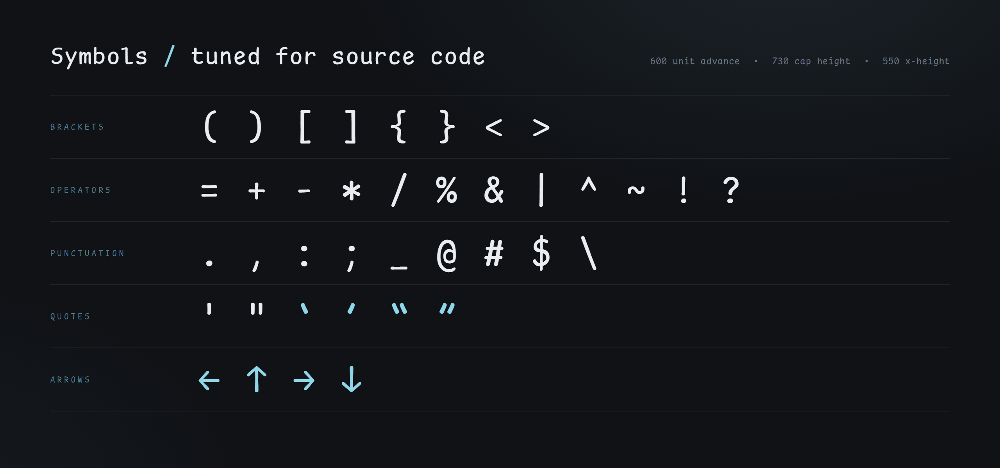

# Sleet Mono

A monospaced programming typeface with a casual, hand-drawn Comic style.
Open forms, generous spacing, made for reading code.



## Why Sleet Mono

I love Comic-style typefaces, but I wasn't happy with some of the glyph metrics in
[Comic Shanns](https://github.com/shannpersand/comic-shanns). So I started from its
outlines and reworked the proportions myself, using
[JetBrains Mono](https://github.com/JetBrains/JetBrainsMono) as a reference for the
vertical metrics and spacing.

## Character set

Currently **103 glyphs**: complete Basic Latin (`U+0020`–`U+007E`), plus curly quotes
and arrows. More glyphs and additional weights are in progress.



## In use



## Symbols



## Installation

### Homebrew (macOS)

```sh
brew install --cask Case3y/fonts/font-sleet-mono
```

For the Nerd Font patched build, which adds terminal and editor icons:

```sh
brew install --cask Case3y/fonts/font-sleet-mono-nerd-font
```

### Manual

Download `SleetMono-Regular.ttf` from [`fonts/`](fonts/), then install it with your
system font manager.

## Credits

- Glyph outlines derived from [Comic Shanns](https://github.com/shannpersand/comic-shanns)
  by Shannon Miwa.
- Glyph proportions and vertical metrics referenced from
  [JetBrains Mono](https://github.com/JetBrains/JetBrainsMono).

## License

Sleet Mono is licensed under the [MIT](LICENSE) License. 
